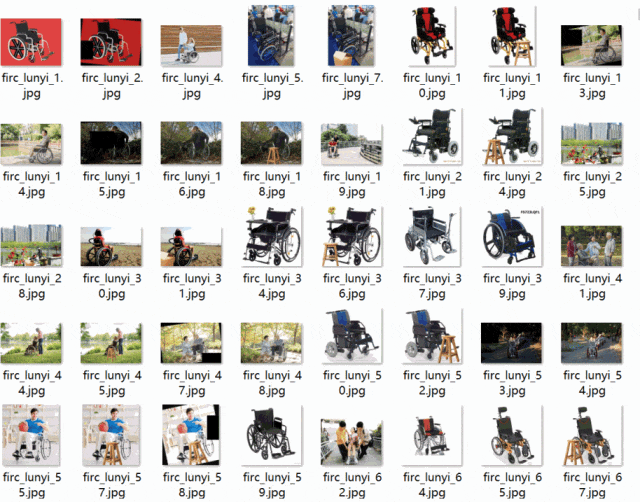

# [Dataset] Object Detection

Dataset format: Pascal VOC format + YOLO format (txt files without split paths, only containing jpg images and corresponding VOC format xml files and yolo format txt files)
Number of images (number of jpg files): 13826
Number of annotations (number of xml files): 13826
Number of annotations (number of txt files): 13826
Number of annotation categories: 1
Annotation category names: ["wheelchair"]
Number of bounding boxes per category:
- wheelchair bounding box count = 15816
Total bounding box count: 15816
Labeling tool used: labelImg
Annotation rules: draw a rectangle around the category
Important note: About 3/4 of the dataset was added by increasing images. Please refer to the following image examples for details.
Special statement: This dataset does not guarantee the accuracy or weights of the trained models or weight files, only accurate and reasonable annotations are provided.

Image example:

Annotation example:

Below are the details about our services. If you have any needs, feel free to contact us through the WeChat public account. We will be happy to serve you. Our contact information is provided in the WeChat public account and can be easily found at any time.

The services we can provide include the following but are not limited to the following areas:

## Payment

Here is a pay link on Stripe ( https://buy.stripe.com/3cs8yP7sY87d0vu9AB ). Please contact me lonlonago@foxmail.com after funding $89, and I will send you a complete data files , thank you!

